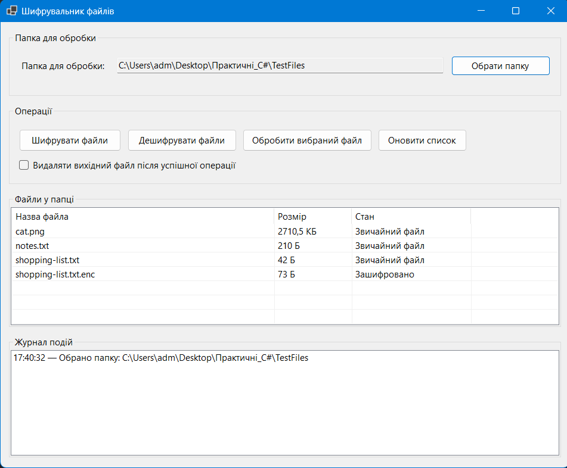
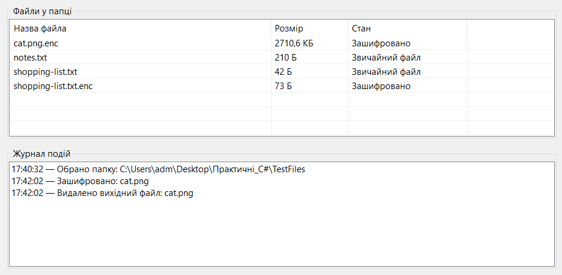
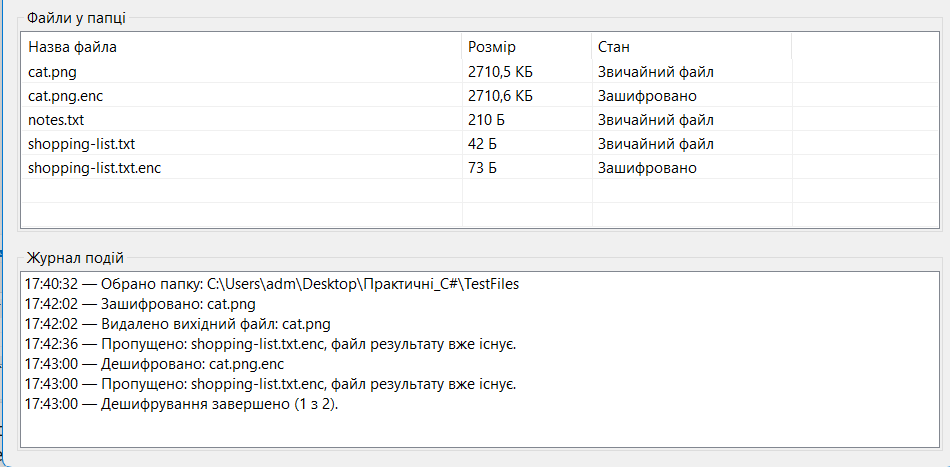

# Лабораторна робота №1.1

**Тема:** Робота з файловою системою у C#  
**Студентка:** Максименко Марія  
**Група:** КН-22  
**Варіант:** 21 — «Шифрувальник файлів»  
**Дата:** 02.10.2026

## 1. Мета роботи

Набути практичних навичок роботи з файлами й папками в C#, а також розробити графічний застосунок для безпечного шифрування та дешифрування файлів.

## 2. Завдання

Розробити Windows Forms-застосунок «Шифрувальник файлів», який дозволяє обирати папку, переглядати її вміст, шифрувати й дешифрувати один або всі файли, вести журнал подій та обробляти помилки файлової системи.

## 3. Використані засоби

- C#, .NET 9 і Windows Forms;
- `System.IO` для роботи з файлами та папками;
- `System.Security.Cryptography`;
- AES-GCM для шифрування даних;
- Windows DPAPI (`ProtectedData`) для захищеного зберігання ключа поточного користувача.

## 4. Опис реалізації

Після вибору папки програма виводить список файлів із назвою, розміром та станом. Користувач може шифрувати всі звичайні файли, дешифрувати файли з розширенням `.enc` або обробити один вибраний файл.

Для шифрування застосовано AES-GCM. Для кожної операції створюється випадковий nonce, а разом із зашифрованими даними записується тег автентичності. Результат шифрування зберігається у файлі з доданим розширенням `.enc`. Ключ генерується один раз і зберігається локально в захищеному вигляді через DPAPI.

За бажанням користувач може увімкнути видалення вихідного файла після успішного створення результату. Програма не перезаписує існуючі файли результату та відображає відповідне повідомлення в журналі.

## 5. Інтерфейс застосунку

Головна форма містить поле вибраної папки, кнопки операцій, прапорець видалення вихідного файла, таблицю файлів і журнал подій.

*Рисунок 1 — Головна форма застосунку після вибору папки з тестовими файлами.*

## 6. Демонстрація роботи

Під час шифрування файла `cat.png` створено файл `cat.png.enc`. Прапорець видалення вихідного файла був увімкнений, тому після успішного шифрування початковий файл `cat.png` видалено. У журналі відображено обидві операції.

*Рисунок 2 — Результат шифрування файла та видалення його вихідної версії.*

Під час дешифрування файла `cat.png.enc` відновлено `cat.png`. Для файла `shopping-list.txt.enc` операцію пропущено, оскільки файл результату `shopping-list.txt` уже існував. Це запобігає випадковому перезапису даних.

*Рисунок 3 — Результат дешифрування та обробка конфлікту імен файлів.*

## 7. Висновок

У роботі реалізовано застосунок для шифрування та дешифрування файлів із графічним інтерфейсом. Програма забезпечує вибір папки, перегляд її вмісту, пакетну та одиночну обробку файлів, журналювання операцій і безпечну поведінку за наявності файла результату. Для захисту даних використано AES-GCM, а для локального зберігання ключа — Windows DPAPI.
